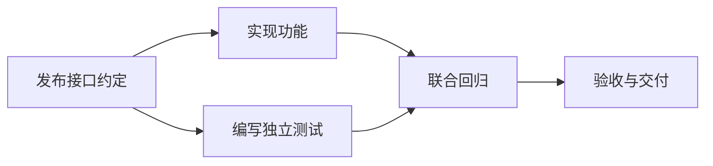
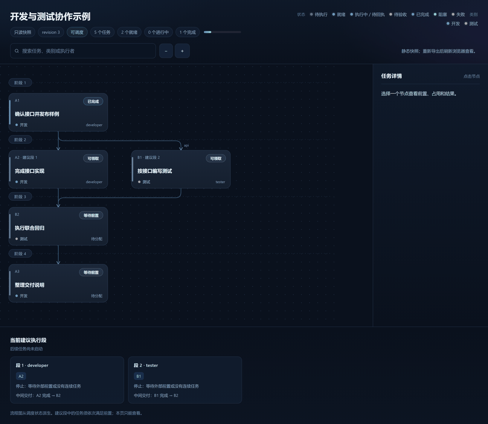

# Multi-Agent Dynamic Task Scheduler

面向 **DeepSeek Harness** 的多 Agent 开发与测试调度插件：用一个 Lead 协调多个专项会话，按依赖推进任务，自动唤醒等待成员，并通过流程图查看项目进度。

## 为什么需要它

多会话协作中，开发、测试和文档往往互相等待。主对话需要反复转述交付物、确认前置、重新派发任务，执行细节也容易挤满上下文。

这个插件把依赖和运行状态保存为任务图，让专项成员保留各自的会话。成员交付后，插件检查下一批就绪任务并发送委托，Lead集中处理计划、关键验收和异常。

## 工作方式



- **依赖感知调度**：检查缺失前置和依赖环，根据优先级、下游任务数量与文件资源占用选择任务。
- **连续执行段**：合并同一成员可连续推进的任务建议，实际启动时逐项检查前置条件。
- **自动派发与唤醒**：依赖解除后给等待成员发送委托，可恢复已自然卸载成员的原有 Session。
- **可视化流程图**：展示类别、状态、负责人、等待原因和交付点，支持搜索、缩放与详情查看。
- **轻量状态管理**：本地JSON保存任务与运行历史；普通任务直接提交，关键节点可配置验收或启动授权。

核心调度逻辑独立于Harness，使用Node.js标准库；当前已提供的聊天平台适配器是DeepSeek Harness。

## 界面预览



只读流程图按依赖阶段自上而下排布，同一阶段内按类别分组；节点显示状态、类别和执行者，下方列出当前建议执行段与中间交付点，支持搜索、缩放和点选查看详情。图为演示数据。

## 快速体验

需要 **Node.js 22+** 和npm。仅体验规划与流程图，不需要安装Harness或配置模型。

```sh
git clone https://github.com/Mr-timeor/Multi-Agent-Dynamic-Task-Scheduler.git
cd Multi-Agent-Dynamic-Task-Scheduler
npm ci
npm run demo
```

用浏览器打开生成的 `.scheduler/flow.html`。演示读取[开发测试示例](fixtures/development.json)，生成任务计划和流程图，不执行模型或业务代码。

使用自己的任务文件：

```sh
node dist/cli.js plan path/to/tasks.json
node dist/cli.js graph path/to/tasks.json .scheduler/plan.html
```

## 在Harness中协作开发

1. 构建并安装调度器bundle，可选安装只读图bundle。
2. 准备项目的任务JSON和任务卡，填写依赖、交付要求与文件范围。
3. 配置任务/状态路径，开启 `autoDispatch`，重启Harness并绑定一个Lead。
4. Lead创建专项成员；成员用 `next` 领取、`report` 交付，插件负责依赖解除后的消息唤醒。

完整安装、配置与启动示例见 **[快速开始](docs/快速开始.md)**。

四个宿主工具：

| 工具 | 用途 |
|---|---|
| `scheduler_status` | 查看任务状态、建议执行段和等待原因 |
| `scheduler_next` | 专项成员领取或确认任务 |
| `scheduler_report` | 提交结果、产物引用或失败原因 |
| `scheduler_manage` | Lead创建成员、验收、授权、暂停及处理异常 |

在Harness文件预览中打开导出的流程图，即可随状态变化查看进度；图本身只读。

## 当前范围

这是早期版本，当前适合预先定义任务图的单项目开发测试协作。Harness集成已在 **Windows / Desktop 0.2.1-rc.2** 验证，其他宿主版本需核对接口兼容性。

- 单个安装实例绑定一个项目和一个Lead，不支持多个Lead接管或运行中切换项目。
- 图不能编辑任务或拖改依赖；现有聊天工具尚未提供任务图增删改入口。
- 文件资源互斥依靠声明，不提供自动worktree或文件系统隔离。
- 已有状态不会随任务JSON修改而自动重载；宿主重启后的未结束运行需要对账。
- 当前算法是贪心列表调度与连续链融合，不预测模型耗时，不承诺全局最优。

已有真实模型协作示例完成九项开发测试任务，两轮测试各123/123通过，Lead无需手动dispatch。验证记录见[开发测试流程评审](docs/worklist-03评审.md)；这些结果不代表已证明效率、费用或上下文压缩收益。

## 开发

```sh
npm test               # 离线测试
npm run benchmark      # 合成任务图与策略比较
npm run package:local  # 生成独立本地分发目录
```

`package:local` 不更新已安装的bundle；`npm run build` 会更新仓库内的调度器bundle。宿主探针依赖本机Harness路径，运行方式见[接入说明](docs/使用与接入.md)。

## 文档

- [快速开始](docs/快速开始.md)：安装、任务准备、配置和首轮运行。
- [调度算法](docs/调度算法.md)：排序、资源约束、执行段与事件触发机制。
- [接口与数据格式](docs/接口与数据契约.md)：任务字段、状态和工具接口。
- [设计方案](docs/设计方案.md)：核心、调配器与可视化的职责。
- [评测方法](docs/离线评测.md)：基线、指标与结果边界。

## License

[MIT](LICENSE)。宿主与第三方依赖遵守各自的许可证。
